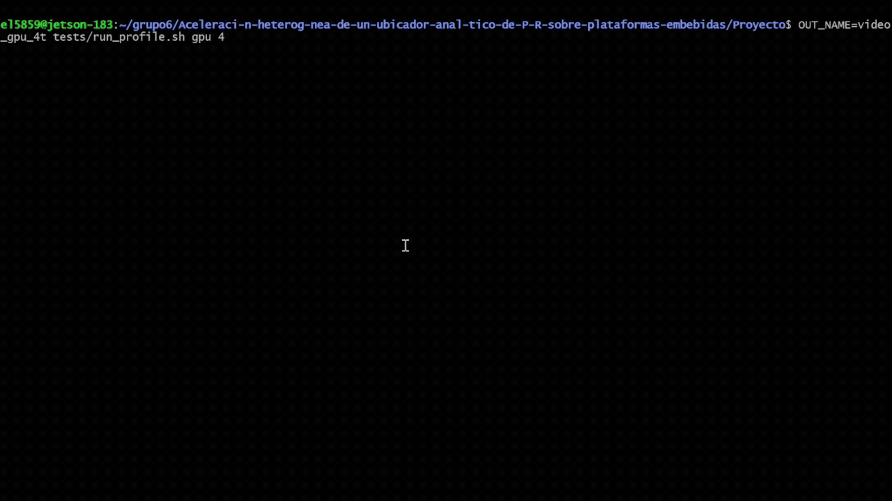

# Aceleración heterogénea de un ubicador analítico de P&R sobre plataformas embebidas

Ubicador analítico de código abierto para circuitos integrados (ASIC) desarrollado en C con aceleración multihilo (OpenMP). Inspirado en las arquitecturas de **RePlAce** y **OpenPARF**, diseñado para ejecutar el pipeline completo de Place and Route (P&R).

------------

## Integrantes, curso y profesor

### Integrantes

1. Fiorela Chavarría Castrillo
2. Fabián Parreaguirre Hidalgo
3. Brayan Rodríguez Villalobos

### Curso

Introducción a la Computación Heterogénea - EL-5859

### Profesor

Dr. Luis G. León-Vega

------------------------


## Requisitos

``` bash
sudo apt-get update && sudo apt-get install -y build-essential gcc make libomp-dev python3-pandas python3-tabulate
``` 

## Compilación

``` bash
make
```


# Ejecutar un benchmark de prueba (ej. adaptec1)

``` bash
./build/placer bench/ispd2005/adaptec1.aux
```

## Etapas del prototipo

### Prototipo completo en CPU: 


parser, wirelength, densidad, Nesterov, legalización y
salida. Cada etapa sigue el diseño de **RePlAce** u **OpenPARF** según
cuál de los dos resuelve ese problema de forma más simple o más cercana a lo que
requerido.

**#1 — Estructuras y firmas.** Structs del circuito (celdas, redes, pines) y los
headers de cada módulo. Sigue a **RePlAce**: celda con posición y bandera de "fija",
pin como desplazamiento respecto al centro de su celda — modelo de ASIC, sin los
conceptos de FPGA (sites, recursos, clock regions) de OpenPARF.

**#2 — Parser de bookshelf.** Lee `.aux`, `.nodes`, `.nets`, `.pl` y `.scl` 
línea por línea. Sigue a **OpenPARF**, el único de los dos con lector de bookshelf;
dado que RePlAce solo lo escribe, usa un generador de parsers (flex/bison) en su lugar.

**#3 — Wirelength.** HPWL exacto más una versión suavizada con gradiente para el
descenso posterior. Mismo patrón de **OpenPARF**: el HPWL exacto va separado de la
versión suave, que usa el esquema estándar de `gamma` por red.

**#4 — Densidad.** Resuelve la ecuación de Poisson (qué tan amontonadas quedan las
celdas y hacia dónde empujarlas) con una transformada DCT propia, no la de
**RePlAce** (~8000 líneas de otro autor). El modelo de overlap es igual en RePlAce y
OpenPARF.

**#5 — Nesterov y control de densidad.** Ciclo que combina wirelength y densidad;
mueve las celdas con el método de gradiente acelerado de Nesterov, siguiendo las
reglas de **RePlAce** para el peso de densidad (`lambda`) y el ajuste del paso, más
simples que las de OpenPARF. Como Nesterov no garantiza que el HPWL baje en cada
iteración, se conserva el mejor punto visto, no el último. `lambda` se recalibra con
un promedio móvil (en vez de la proporción cruda de cada iteración) y con una
escalada activa si el overflow no mejora en una ventana de 300 iteraciones (ninguna
de las dos referencias lo necesita porque no arrancan del mismo initial placement).

**#6 — Legalización y salida.** Initial placement propio por mínimos cuadrados
(gradiente conjugado, cada red como un resorte) antes de correr densidad, porque el
`.pl` de entrada llega amontonado en un punto. Legalización estilo Abacus por fila:
agrupa celdas que se traslaparían y recoloca cada grupo en su óptimo de mínimo
desplazamiento al cuadrado, no un barrido que solo evita el traslape; una fila que
recibe más celdas de las que caben pasa el sobrante a la fila vecina. Abacus es el
legalizador estándar en ubicadores analíticos, no un rasgo distintivo de RePlAce ni
de OpenPARF. Se agregan métricas (overflow, utilización, tiempo de pared) y una
visualización PPM propia sin dependencias.

Se prueba con 4 circuitos: `adaptec1`, `adaptec2` y `bigblue1`
(ISPD 2005) y `newblue1` (ISPD 2006), de 211 a 330 mil celdas. Estos circuitos forman parte de un set estandarizado de circuitos digitales que están disponibles gracias a la ISPD(International Symposium on Physical Design).


## Organización de los módulos

- **`include/`** y **`src/`** contienen un módulo por responsabilidad: `netlist`,
  `bookshelf` (+ `_nodes`, `_nets`, `_pl`, `_scl`), `wirelength`, `density`, `dct`,
  `grid`, `optimizer`, `initial_place`, `legalize`, `viz`, el ciclo `place` y
  `main`, más dos ayudas internas (`lineio`, `strmap`).
- **`tests/`** contiene una prueba por módulo, se corren con `make test`. Los casos de
  `initial_place` y `legalize` están verificados a mano (dos resortes iguales se
  encuentran a medio camino, dos celdas con el mismo destino se reparten
  simétricamente), igual que el HPWL=73 del circuito de juguete.
- **`bench/`** contiene `toy/` (inventado, resultado calculado a mano), `ispd2005/`
  (`adaptec1`, `adaptec2`, `bigblue1`) e `ispd2006/` (`newblue1`).
- **`build/`** contiene lo que genera `make`.

## Pruebas

```bash
cd Proyecto
make
./build/placer bench/toy/toy.aux
./build/placer bench/ispd2005/adaptec1.aux
./build/placer bench/ispd2005/adaptec2.aux
./build/placer bench/ispd2005/bigblue1.aux
./build/placer bench/ispd2006/newblue1.aux
```

Cada corrida imprime progreso cada 100 iteraciones y al final deja dos archivos junto
al benchmark: `<circuito>.out.pl` (posiciones finales, formato bookshelf) y
`<circuito>.ppm` (imagen del layout, celdas movibles en azul y fijas en rojo).

A continuación se presenta cómo se visualiza el archivo `adaptec1.ppm`


## Resultados

HPWL final (con initial placement, Nesterov y legalización) contra el publicado por
RePlAce para los mismos benchmarks:

| Circuito | Celdas | Nuestro HPWL | RePlAce (Tabla V, TCAD) | Razón |
|---|---|---|---|---|
| adaptec1 | 211,447 | 1.549e8 | 7.501e7 | 2.07x |
| adaptec2 | 255,023 | 2.420e8 | 8.185e7 | 2.96x |
| bigblue1 | 278,164 | 1.300e8 | 8.905e7 | 1.46x |
| newblue1 | 330,474 | 1.508e9 | 5.744e7 | 26.25x |

Promediando `adaptec1`, `adaptec2` y `bigblue1`: ~2.16x el HPWL de RePlAce, razonable
para un prototipo académico sin el ajuste fino de un ubicador de producción.
`newblue1` es la excepción: en ese circuito el overflow cruza el objetivo antes de
que wirelength tenga tiempo de acomodarse, y el HPWL final queda muy por encima del
resto, limitación conocida del control de densidad actual (ver **#5**), pendiente
de ajuste.


### ¿Por qué no se compara contra OpenPARF?

Porque no mide lo mismo. OpenPARF ubica para FPGA (sites, LUTs, BRAMs, recursos
heterogéneos), no para ASIC estándar como estos benchmarks ISPD; su HPWL no es
comparable contra esta propuesta. RePlAce sí: mismo modelo de ASIC, mismos benchmarks.

## Optimizaciones

Se probó paralelismo por tareas (OpenMP), banderas del compilador y alineación de
memoria. Cada una se midió aparte antes de aprobarla. Varias de las opciones que teoricamente podían brindar mejores resultados demostraron resultados más deficientes y fueron descartadas en lugar de forzarlas.

**Aplicadas:**

- **OpenMP** en las tres partes con trabajo real por celda/bin: filas y columnas del
  DCT (~1.6x medido en aislado), el bucle de redes de wirelength (~2x), y el reparto
  de área + gradiente de densidad. Donde varias celdas pueden tocar el mismo bin se
  usa `#pragma omp atomic`.
- **Alineación a 64 bytes** (una línea de cache) en los arreglos de la grilla y en
  la tabla de cosenos del DCT, los más leídos de todo el programa.
- **`-O3`**: ayuda a wirelength (~7%, tiene `exp` que vectoriza mejor), no cambia
  nada en densidad (ahí el costo es acceso a memoria del DCT, no cómputo).
- Se sacó del camino caliente una cuenta que no depende de la posición de las
  celdas (área movible total): se calcula una sola vez en vez de en cada llamada.

**Probadas y no aplicadas:**

- Paralelizar el campo eléctrico, el escalado de Poisson y las sumas de
  energía/overflow: cada bin hace muy poco trabajo (una resta, una división), y
  abrir un bloque paralelo demostró ser más lento que en serie.
- Reordenar los structs de celdas (arreglo-de-structs a struct-de-arreglos): el
  costo real está en la grilla y el DCT, no en recorrer celdas.

**Tiempos** (pipeline completo con initial placement y legalización, mismo
circuito antes y después: `-O2` sin OpenMP contra `-O3 -fopenmp` en 8 núcleos):

| Circuito | Sin optimizar | Optimizado | Mejora |
|---|---|---|---|
| adaptec1 | 195.2 s | 127.2 s | 1.53x |
| adaptec2 | 220.8 s | 163.3 s | 1.35x |
| bigblue1 | 249.3 s | 177.1 s | 1.41x |
| newblue1 | 242.2 s | 149.1 s | 1.62x |

La mejora es más modesta que en microbenchmarks aislados porque el pipeline
completo incluye partes sin paralelizar (initial placement por gradiente
conjugado, legalización) que ahora pesan una fracción real del tiempo total.

<details>
<summary><b> Salida de los benchmarks (Haz clic para desplegar)</b></summary>

<br>


```
$ ./build/placer bench/ispd2005/adaptec1.aux
celdas: 211447  redes: 221142  pines: 944053
utilizacion: 75.5%
HPWL inicial: 1.049242e+08
  iter    0: HPWL 6.7997e+07  overflow 0.821
  iter  100: HPWL 6.6654e+07  overflow 0.751
  iter  200: HPWL 6.6920e+07  overflow 0.741
  iter  300: HPWL 6.7590e+07  overflow 0.731
  iter  400: HPWL 6.8019e+07  overflow 0.722
  iter  500: HPWL 6.8571e+07  overflow 0.715
  iter  600: HPWL 6.9030e+07  overflow 0.706
  iter  700: HPWL 6.9442e+07  overflow 0.699
  iter  800: HPWL 6.9879e+07  overflow 0.694
  iter  900: HPWL 7.0345e+07  overflow 0.689
HPWL sin legalizar: 9.214002e+07  overflow: 0.290  tiempo: 127.2 s
HPWL legalizado: 1.549216e+08
posiciones finales: adaptec1.out.pl
imagen del layout: adaptec1.ppm
```

```
$ ./build/placer bench/ispd2005/adaptec2.aux
celdas: 255023  redes: 266009  pines: 1069482
utilizacion: 77.7%
HPWL inicial: 1.477710e+08
  iter    0: HPWL 8.4744e+07  overflow 0.828
  iter  100: HPWL 8.4631e+07  overflow 0.618
  iter  200: HPWL 8.7797e+07  overflow 0.540
  iter  300: HPWL 8.9779e+07  overflow 0.491
  iter  400: HPWL 9.0823e+07  overflow 0.474
  iter  500: HPWL 9.1574e+07  overflow 0.460
  iter  600: HPWL 9.2227e+07  overflow 0.452
  iter  700: HPWL 9.2693e+07  overflow 0.444
  iter  800: HPWL 9.3149e+07  overflow 0.438
  iter  900: HPWL 9.3655e+07  overflow 0.431
HPWL sin legalizar: 9.409847e+07  overflow: 0.424  tiempo: 163.3 s
HPWL legalizado: 2.419512e+08
posiciones finales: adaptec2.out.pl
imagen del layout: adaptec2.ppm
```

```
$ ./build/placer bench/ispd2005/bigblue1.aux
celdas: 278164  redes: 284479  pines: 1144691
utilizacion: 58.3%
HPWL inicial: 1.105385e+08
  iter    0: HPWL 7.1163e+07  overflow 0.816
  iter  100: HPWL 6.8914e+07  overflow 0.765
  iter  200: HPWL 6.9576e+07  overflow 0.757
  iter  300: HPWL 6.9969e+07  overflow 0.753
  iter  400: HPWL 7.0168e+07  overflow 0.752
  iter  500: HPWL 7.0352e+07  overflow 0.749
  iter  600: HPWL 7.0630e+07  overflow 0.747
  iter  700: HPWL 9.6228e+07  overflow 0.507
  iter  800: HPWL 1.1765e+08  overflow 0.193
  iter  900: HPWL 1.1484e+08  overflow 0.198
HPWL sin legalizar: 1.137264e+08  overflow: 0.197  tiempo: 177.1 s
HPWL legalizado: 1.300189e+08
posiciones finales: bigblue1.out.pl
imagen del layout: bigblue1.ppm
```

```
$ ./build/placer bench/ispd2006/newblue1.aux
celdas: 330474  redes: 338901  pines: 1244342
utilizacion: 69.9%
HPWL inicial: 2.377696e+07
  iter    0: HPWL 4.7787e+07  overflow 0.689
  iter  100: HPWL 9.8253e+07  overflow 0.425
  iter  200: HPWL 2.3475e+08  overflow 0.280
  iter  300: HPWL 2.6856e+08  overflow 0.142
  iter  400: HPWL 4.2101e+08  overflow 0.101
  iter  500: HPWL 4.2941e+08  overflow 0.145
  iter  600: HPWL 3.5792e+08  overflow 0.166
  iter  700: HPWL 3.9694e+08  overflow 0.150
  iter  800: HPWL 2.9260e+08  overflow 0.140
HPWL sin legalizar: 5.071406e+07  overflow: 0.454  tiempo: 149.1 s
HPWL legalizado: 1.507746e+09
posiciones finales: newblue1.out.pl
imagen del layout: newblue1.ppm
```

</details>

## Perfilado

Se desarrolló un script de bash `run_bench.sh` ubicado en la carpeta `tests` que corre el programa una cantidad determinada de veces y genera un archivo csv con los siguientes datos:

- task-clock
- cycles
- instructions
- cache-references
- cache-misses
- L1-dcache-loads
- L1-dcache-load-misses
- LLC-loads
- LLC-load-misses
- branch-instructions
- branch-misses


Luego se utiliza un script de Python, que requiere de la biblioteca `pandas`, para hacer un análisis estadístico y presentar los datos como una tabla.

### Ejecución

``` bash 
cd Proyecto/tests
chmod +x run_bench.sh
./run_bench.sh <número de iteraciones> <dirección del archivo .aux>
```

Por ejemplo:

``` bash 
cd Proyecto/tests
chmod +x run_bench.sh
./run_bench.sh 5 bench/ispd2005/adaptec1.aux
```


### Resultados

Se ejecutó estas pruebas en las computadoras de Brayan y Fabián. Hace falta ejecutarlo en un sistema empotrado debido a que no se logró accesar en el momento requerido.

#### Resultados de Brayan


### Resumen de Desempeño y Muestreo de Hardware (`perf`)

| Benchmark   | Time (s)         |   Cycles (M) |    Inst (M) |   IPC | Cache Miss %   | Branch Miss %   |
|:------------|:-----------------|-------------:|------------:|------:|:---------------|:----------------|
| adaptec1    | 414.293 ± 3.342  |  1.57013e+06 | 1.54764e+06 | 0.986 | 1.16%          | 4.23%           |
| adaptec2    | 475.144 ± 1.918  |  1.79676e+06 | 1.74616e+06 | 0.972 | 1.48%          | 4.48%           |
| bigblue1    | 513.390 ± 3.691  |  1.94044e+06 | 1.85835e+06 | 0.958 | 1.69%          | 4.69%           |
| newblue1    | 472.912 ± 17.194 |  1.81746e+06 | 1.73752e+06 | 0.956 | 1.64%          | 5.07%           |


#### Resultados de Fabián


### Resumen de Desempeño y Muestreo de Hardware (`perf`)

| Benchmark   | Time (s)         |   Cycles (M) |    Inst (M) |   IPC | Cache Miss %   | Branch Miss %   |
|:------------|:-----------------|-------------:|------------:|------:|:---------------|:----------------|
| adaptec1    | 592.400 ± 8.791  |  1.49059e+06 | 1.49045e+06 | 1     | 29.61%         | 4.28%           |
| adaptec2    | 646.577 ± 4.157  |  1.64634e+06 | 1.68465e+06 | 1.023 | 30.17%         | 4.55%           |
| bigblue1    | 673.682 ± 1.223  |  1.72824e+06 | 1.79431e+06 | 1.038 | 29.62%         | 4.73%           |
| newblue1    | 597.647 ± 14.440 |  1.54517e+06 | 1.65695e+06 | 1.072 | 32.42%         | 4.92%           |

### Perfilado por etapa

Para identificar qué parte del pipeline conviene acelerar primero, se instrumentó el código con `clock_gettime` alrededor de cada etapa: parseo, initial placement, ciclo de Nesterov, legalización y escritura. Se realizó una corrida por circuito.

Se confirma que el ciclo de Nesterov domina más del *95 %* del tiempo total en los cuatro circuitos. Esto valida la decisión de acelerar precisamente estos dos núcleos en la arquitectura propuesta.

#### Tiempo de pared por etapa

| Circuito   | Parseo (s) | Init. (s) | Nesterov (s) | Legal. (s) | Escr. (s) |
| :--------- | ---------: | --------: | -----------: | ---------: | --------: |
| `adaptec1` |       0.78 |      1.38 |       137.13 |       0.66 |      0.18 |
| `adaptec2` |       0.89 |      1.83 |       165.18 |       1.09 |      0.22 |
| `bigblue1` |       1.03 |      1.96 |       180.28 |       0.93 |      0.22 |
| `newblue1` |       1.10 |      2.17 |       170.37 |       5.90 |      0.25 |

**Observación:** el ciclo de Nesterov representa más del 95 % del tiempo de ejecución en todos los circuitos evaluados, por lo que constituye el principal candidato para la aceleración. Dentro de este ciclo, los cálculos de longitud de cable y densidad son los núcleos seleccionados para la arquitectura propuesta.


## Prototipo en Acelerador I (Jetson Nano)

### Ejecución

Todo se corre en la misma Jetson Nano del curso que nos facilitó el profesor, que ya trae JetPack 4.6 con CUDA 10.2 y gcc 7.5, por lo que no hace falta instalar nada.

``` bash
cd Proyecto
sudo nvpmodel -m 0 && sudo jetson_clocks
make && make gpu
tests/run_profile.sh cpu 4
tests/run_profile.sh gpu 4
python3 tests/profile_report.py results/jetson/cpu_4t results/jetson/gpu_4t > results/jetson/reporte.md
```

Esto deja la Jetson en su modo de máximo rendimiento para asegurar un performance parecido entre corridass, compila la versión solo CPU y la versión con GPU, y corre los cuatro circuitos benchmark de a uno, primero en CPU con sus cuatro núcleos y después con la GPU. Las dos versiones van instrumentadas, así que cada corrida guarda el tiempo de cada etapa en cada iteración dentro de `results/jetson/cpu_4t/` y `results/jetson/gpu_4t/`. Al final, `profile_report.py` junta todo en `results/jetson/reporte.md`, con las tablas por etapa y la mejora de la GPU sobre la CPU. La parte de CPU tarda unos 25 minutos y la de GPU unos 7.

Los resultados que se muestran en esta sección salen de una corrida que ya se hizo en la Jetson para validar los datos, y están guardados en `Proyecto/results/jetson/`: la línea base en `cpu_base_4t/`, la versión con GPU en `gpu_4t/` y el reporte completo en `reporte_etapas.md`. Si se vuelve a correr el comando de arriba, los resultados nuevos de la GPU reemplazan los de `gpu_4t/`.

Si se quiere ejecutar únicamente la versión GPU, sin volver a correr la línea base en CPU, se puede utilizar el siguiente comando:

tests/run_profile.sh gpu 4

Para evitar sobrescribir los resultados anteriores, se utilizó `OUT_NAME` para guardar la nueva ejecución en una carpeta diferente:

OUT_NAME=video_gpu_4t tests/run_profile.sh gpu 4

En este caso, los archivos generados quedan en results/jetson/video_gpu_4t/, mientras que los resultados de gpu_4t/ se mantienen sin cambios.

### Línea base en la CPU de la Jetson

Antes de tocar la GPU se corrió el prototipo en C usando solo los cuatro núcleos de la Jetson. Esos tiempos son la línea base contra la que se compara la versión acelerada. Para ver qué partes pesan más se instrumentó el ciclo de Nesterov con chrono (`clock_gettime`): cada iteración guarda cuánto tardó cada etapa, lo que da entre 800 y 1000 muestras por etapa en cada circuito.

| Circuito | Tiempo total (s) | Longitud de cable | Densidad | Calibración de lambda |
| :--- | ---: | ---: | ---: | ---: |
| `adaptec1` | 559.3 | 19.1 % | 32.2 % | 46.1 % |
| `adaptec2` | 649.6 | 19.6 % | 28.3 % | 49.3 % |
| `bigblue1` | 678.7 | 22.4 % | 27.4 % | 47.4 % |
| `newblue1` | 661.9 | 18.8 % | 23.4 % | 55.1 % |

Los porcentajes son del ciclo de Nesterov, que es más del 97 % de cada corrida. Entre las tres etapas suman el 97 % del ciclo. La que más pesaba era la calibración de lambda, que ordenaba con `qsort` todos los gradientes solo para sacar una mediana, y lo hacía en un solo hilo.

### Módulos llevados a la GPU

Con CUDA se llevaron a la GPU los dos cálculos que se repiten en cada iteración. La longitud de cable (`wirelength_gpu.cu`) usa un hilo por red para calcular el promedio ponderado y su gradiente. La densidad (`density_gpu.cu`) reparte el área de las celdas en la grilla, resuelve la ecuación de Poisson y saca el campo y el gradiente de cada celda. Como cuFFT no trae una DCT, `dct_gpu.cu` la arma a partir de una FFT real, lo que además baja su costo de O(n²) a O(n log n) por línea. `backend.c` decide si estos cálculos corren en la CPU o en la GPU según cómo se compiló.

En cuanto a optimización, el netlist se sube a la GPU una sola vez al inicio y en cada iteración solo viajan las posiciones de ida y los gradientes de vuelta. Cada hilo de longitud de cable resuelve x e y en la misma pasada, y las sumas se toman desde los extremos de cada red para no perder precisión en `float`. La calibración de lambda se quedó en la CPU, pero se cambió el ordenamiento completo por una selección (quickselect) que da exactamente la misma mediana sin ordenar todo.

### Resultados con la GPU

| Circuito | Línea base CPU (s) | Con GPU (s) | Mejora |
| :--- | ---: | ---: | ---: |
| `adaptec1` | 559.3 | 71.9 | 7.8x |
| `adaptec2` | 649.6 | 91.6 | 7.1x |
| `bigblue1` | 678.7 | 90.5 | 7.5x |
| `newblue1` | 661.9 | 115.2 | 5.7x |

La calidad del resultado se mantiene. Este es el HPWL final, ya legalizado, de cada corrida:

| Circuito | HPWL línea base CPU | HPWL con GPU | Diferencia |
| :--- | ---: | ---: | ---: |
| `adaptec1` | 1.5485e8 | 1.5472e8 | -0.09 % |
| `adaptec2` | 2.4332e8 | 2.4144e8 | -0.77 % |
| `bigblue1` | 1.3034e8 | 1.3032e8 | -0.02 % |
| `newblue1` | 1.5579e9 | 1.5387e9 | -1.23 % |

Las diferencias realmente son mínimas por lo que se puede asegurar que en esencia se llega al mismo resultado con la GPU, la diferencia generada es en parte por la variación entre corridas

La misma instrumentación corre en la versión con GPU, y ahí los kernels y las copias entre CPU y GPU se miden con eventos de CUDA. Así queda una iteración de `adaptec1` a modo de ejemplo:

| Etapa | Línea base CPU (ms) | Con GPU (ms)|
| :--- | ---: | ---: |
| Longitud de cable | 104.0 | 20.3 |
| Densidad (incluye la DCT) | 175.8 | 4.9 |
| Calibración de lambda | 251.6 | 16.7 |
| HPWL y paso de Nesterov | 13.8 | 15.3 |
| Iteración completa | 545.2 | 57.3 |

De esos 57.3 ms, 3.7 son copias entre CPU y GPU, ya contadas dentro de longitud de cable y densidad.

#### Verificación de la ejecución en Jetson Nano

Se corrieron los cuatro benchmarks mediante run_profile.sh, sin repetir la línea base en CPU.

| Circuito | Muestras registradas | HPWL legalizado |
| :--- | ---: | ---: |
| `adaptec1` | 1000 | 1.548198e8 |
| `adaptec2` | 1000 | 2.399293e8 |
| `bigblue1` | 1000 | 1.301608e8 |
| `newblue1` | 802 | 1.554933e9 |

Las muestras corresponden a las iteraciones del ciclo de Nesterov. Los cuatro benchmarks finalizaron correctamente y se generaron los archivos de perfilado, los registros de ejecución y las posiciones finales de las celdas.

Los resultados se guardaron en `results/jetson/video_gpu_4t/`, separados de las mediciones anteriores.

#### Video de demostración

Se grabó una demostración de 57 segundos de la ejecución GPU en la Jetson Nano. En el video se muestran los cuatro benchmarks (`adaptec1`, `adaptec2`, `bigblue1` y `newblue1`) y sus respectivos resultados.

A continuación, se muestra una versión corta, en forma de gif, de la ejecución:

<p align="center">
  
</p>

**Video de demostración:** [Ver video](https://www.youtube.com/watch?v=_g9zemYpb-Q&list=PLZxpsgKPQTyq59WZcApOzAe8b5uaUJxRk&index=1)

### Conclusiones

Llevar la longitud de cable y la densidad a la GPU, junto con el cambio a quickselect, hace la corrida completa entre 5.7 y 7.8 veces más rápida. Solo quickselect ya aporta entre 1.7 y 2.0 veces, y en la densidad parte de la mejora viene de pasar la DCT a FFT. Ahora lo que sigue en la CPU (lambda, el paso de Nesterov y el HPWL) es más de la mitad de cada iteración.

Como trabajo futuro se va a seguir optimizando lo que ya corre en la GPU. Lo primero es el kernel de longitud de cable, que es su parte más lenta (18.2 de los 57.3 ms de una iteración en `adaptec1`) porque cada pin lee posiciones dispersas en memoria, y lo segundo son las copias entre CPU y GPU que se hacen en cada iteración. No se va a pasar todo el algoritmo a la GPU: el ciclo de Nesterov, que orquesta todo el proceso, y el legalizador se quedan en la CPU.


## Dependencias

Se tienen algunas dependencias externas que son manejadas por el archivo `Makefile` y están incluídas en el toolchain de C en linux.

- GCC o Clang para compilar el código en C
- `make` para ejecutar la construcción
- `libm` para funciones matemáticas (`sqrt`, `fabs`, etc.)
- OpenMP (con la bandera `-fopenmp`) para la paralelización del cálculo de densidad y optimización
- Bibliotecas estándar del sistema: `stdio.h`, `stdlib.h`, `string.h`, `math.h`, `time.h`
- Pyhton3 y la biblioteca `pandas` para generar la tabla de resumen de desempeño


## Características de los sistemas


| # | Characteristic | Fabián | Brayan | Fiorela |
|---|---|---|---|---|
| 1 | Processor model | Intel Core i5-1135G7 @ 2.40GHz (11th gen) | AMD A12-9800 RADEON R7, 12 Compute Cores 4C+8G | Intel Core i5-6300U @ 2.40GHz |
| 2 | Architecture | x86_64 | x86_64 | x86_64 |
| 3 | Physical cores | 4 | 4 | 2 |
| 4 | Logical CPUs | 8 | 4 | 4 |
| 5 | Threads per core | 2 (Hyperthreading) | 1 | 2 (Hyperthreading) |
| 6 | Compiler | GCC 15.2.0 (GNU11 + OpenMP) | GCC 15.2.0 (GNU11 + OpenMP) | GCC 15.2.0 (GNU11 + OpenMP) |


## Reconocimiento

Como método de transparencia se reporta el uso de Inteligencia Artificial como herramienta de apoyo para el desarrollo, prueba e implementación del presente proyecto. También se incluye un .md sobre el uso de IA por medio de Claude Code, esto debido a la imposiblidad de compartir links en Claude Code

[Conversación 1](https://share.gemini.google/XbA8yWkuS4I4)

[Conversación 2](https://claude.ai/share/0c3570e5-24fa-414d-b502-ecb8afe9f648).

[Conversación 3](https://chatgpt.com/share/6ab9f86e-1044-83e8-a550-bcb48bb35e09)
